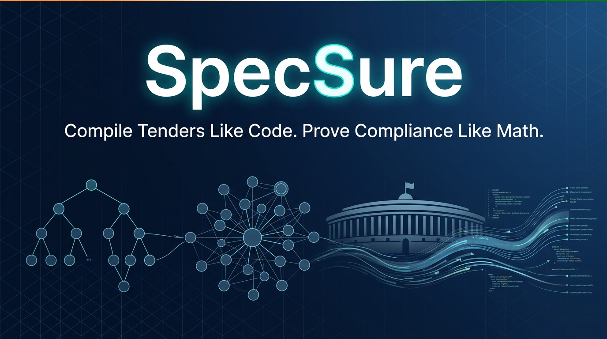
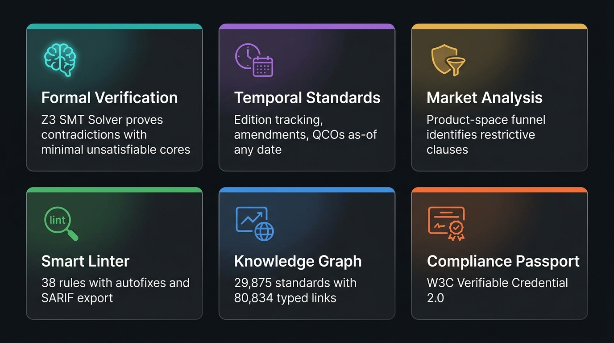
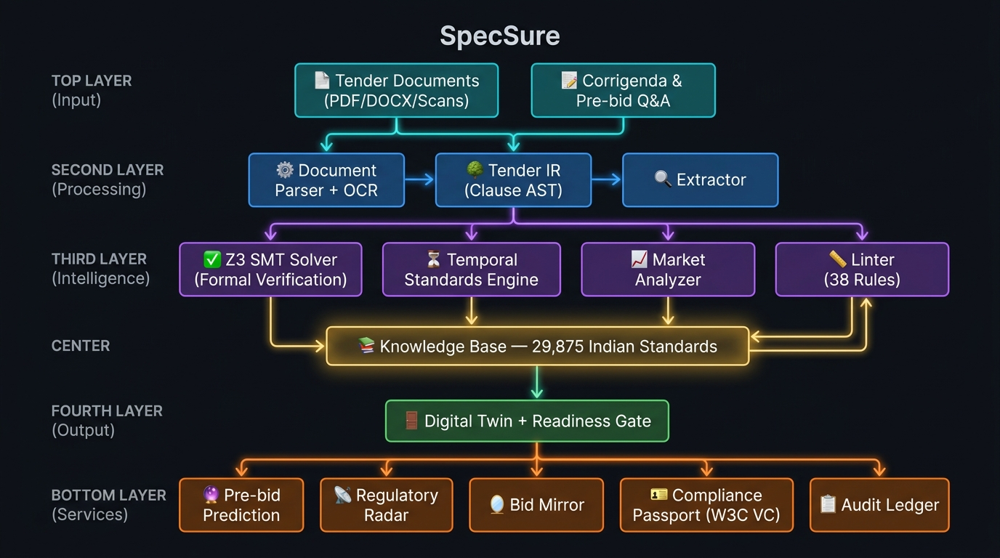
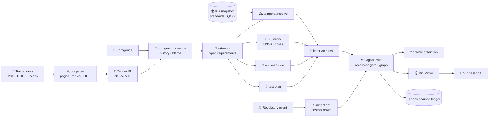
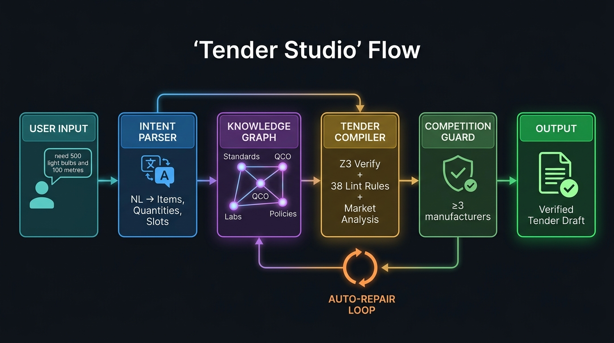
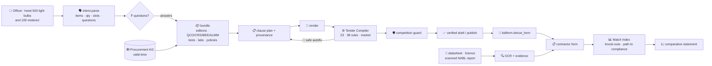
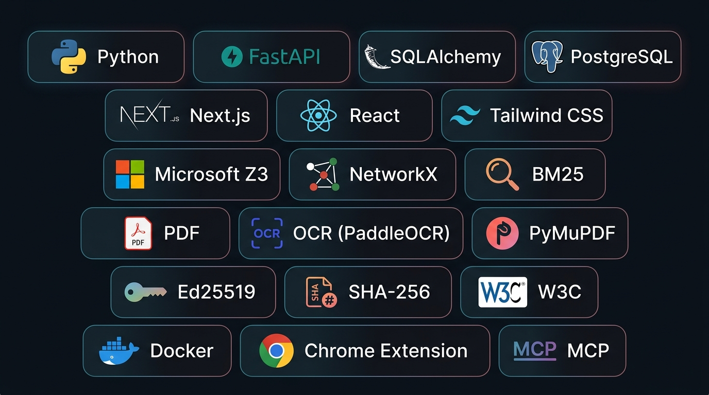

<!-- ━━━━━━━━━━━━━━━━━━━━━━━━━━━━━━━━━━━━━━━━━━━━━━━━━━━━━━━━━━━━━ -->
<!--                         HERO BANNER                          -->
<!-- ━━━━━━━━━━━━━━━━━━━━━━━━━━━━━━━━━━━━━━━━━━━━━━━━━━━━━━━━━━━━━ -->

<p align="center">
  
</p>

<!-- ━━━━━━━━━━━━━━━━  BADGES  ━━━━━━━━━━━━━━━━━━━━━━━━━━━━━━━━━━━ -->

<p align="center">
  <a href="#-quick-start"></a>
  <a href="#-tech-stack"></a>
  <a href="#-tech-stack"></a>
  <a href="#-system-architecture"></a>
  <a href="#-key-numbers"></a>
  <a href="#-key-numbers"></a>
</p>

<p align="center">
  
  
  
  
  
  
</p>

<!-- ━━━━━━━━━━━━━━━━  TAGLINE  ━━━━━━━━━━━━━━━━━━━━━━━━━━━━━━━━━ -->

<h1 align="center">
  🏛️ SpecSure — Tender Intelligence & Standards Compliance
</h1>

<p align="center">
  <b>Compile tenders like code. Prove compliance like math.</b><br>
  <sub>Smart India Hackathon 2026 · Problem Statement SIH26108 · Team CodeNova</sub>
</p>

<p align="center">
  <a href="#-5-minute-demo"><kbd>🎬 Demo</kbd></a>&nbsp;&nbsp;
  <a href="#-system-architecture"><kbd>🏗️ Architecture</kbd></a>&nbsp;&nbsp;
  <a href="docs/api-reference.md"><kbd>📡 API Reference</kbd></a>&nbsp;&nbsp;
  <a href="docs/DEMO_SCRIPT.md"><kbd>📋 Demo Script</kbd></a>&nbsp;&nbsp;
  <a href="docs/PPT_SHOWCASE_GUIDE.md"><kbd>📊 PPT Guide</kbd></a>&nbsp;&nbsp;
  <a href="docs/deck/deck_template.html"><kbd>🎴 Deck</kbd></a>
</p>

---

## 📌 Table of Contents

<details open>
<summary><b>Click to expand</b></summary>

- [What is SpecSure?](#-what-is-specsure)
- [Core Features](#-core-features)
- [What's New in v2.1](#-whats-new-in-v21--one-knowledge-graph-two-sides)
- [Key Numbers](#-key-numbers)
- [5-Minute Demo](#-5-minute-demo)
- [System Architecture](#-system-architecture)
- [Tender Studio Workflow](#-tender-studio-workflow)
- [Standards Recommender](#-standards-recommender--the-full-indian-standards-corpus)
- [Government Portal & Lifecycle](#️-government-portal--full-procurement-lifecycle)
- [Quick Start](#-quick-start)
- [Tech Stack](#-tech-stack)
- [Project Structure](#-project-structure)
- [Competitive Differentiation](#-competitive-differentiation)
- [Data Honesty](#️-data-honesty)
- [Documentation](#-documentation)
- [Team](#-team)

</details>

---

## 💡 What is SpecSure?

<table>
<tr>
<td width="60%">

SpecSure is a **Tender Compiler** — it treats government procurement tenders as source code and applies the same rigorous techniques software engineers use:

- 🌳 **Parsing into an AST** (Abstract Syntax Tree)
- 🔬 **Static analysis** & formal verification (Z3 SMT solver)
- 📦 **Dependency resolution** for standards & regulations
- 🧹 **Linting with SARIF export** (38 rules with autofixes)
- 🌿 **Git-style change tracking** for corrigenda
- 📡 **Dependabot-style monitoring** for regulatory changes

> **Upload a tender** (PDF / DOCX / scanned / pasted, plus corrigenda and pre-bid Q&A) → SpecSure builds a **Tender Digital Twin** and proves compliance mathematically.

</td>
<td width="40%">

```
  📄 Tender Document
       │
       ▼
  ┌──────────┐
  │  Parser  │  ← PyMuPDF · OCR
  └────┬─────┘
       │
       ▼
  ┌──────────┐
  │  Clause  │  ← AST
  │   Tree   │
  └────┬─────┘
       │
       ▼
  ┌──────────┐
  │ Compiler │  ← Z3 · Linter
  └────┬─────┘
       │
       ▼
  ✅ Digital Twin
```

</td>
</tr>
</table>

> [!IMPORTANT]
> **Design principle:** The LLM is **optional and never decides**. All findings come from the parser, rule engine, solver and knowledge base. An LLM may only rephrase a finding or propose items (validated against the catalogue).

---

## ⚡ Core Features

<p align="center">
  
</p>

| | Capability | How (Not a Chatbot) |
|:---:|---|---|
| 🧮 | **Proves contradictions** — _"no product can satisfy Clauses 4.2 ∧ 4.6 ∧ 4.7"_ | Every clause → a constraint; **Z3 SMT solver** returns the *minimal unsatisfiable core* + arithmetic witness |
| 🕰 | **Resolves standards as of the tender date** — withdrawn / merged editions, amendments in force, QCOs taking effect mid-contract | **Temporal Standards Engine** over valid-time intervals |
| 🏪 | **Shows restriction with evidence** — which clause cuts 12 licensed manufacturers to 1, and how many return if relaxed to the IS limit | Product-space **model counting** (leave-one-out, relax-to-standard) · GFR 2017 Rule 144 |
| 🧹 | **Lints the tender** — 38 rules with stable IDs, autofixes, human review that survives re-compilation, **SARIF 2.1.0** export | _"ESLint for tenders"_ |
| 🌿 | **Merges corrigenda like git** — per-clause history, word diffs, blame, and **regression detection** when a corrigendum breaks something | Chronological merge + re-compile + finding diff |
| ❓ | **Predicts pre-bid questions** before publication with evidence-linked draft answers; approved answers flow into a corrigendum | Findings ⊕ institutional memory |
| 📡 | **Re-validates automatically** when a standard, amendment or QCO changes | _"Dependabot for tenders"_ — reverse traversal of the normative-reference graph |
| 🪞 | **Bid Mirror** for contractors — every requirement mapped to the datasheet / BIS licence / NABL report page that proves it (or doesn't) | Deterministic evaluation on normalised units, evidence-strength grading |
| 🛂 | **Product Compliance Passport** — a **W3C Verifiable Credential 2.0**, Ed25519 `eddsa-jcs-2022` proof, `did:key` issuer, QR, verifiable offline | Open standards, no blockchain needed |
| 🔗 | **Tamper-evident audit ledger** — every compile, review and decision is hash-chained with document + KB snapshot + engine version hashes | Transparency-log pattern |
| 🤖 | **MCP server** — any AI assistant can call SpecSure's deterministic tools instead of guessing | Model Context Protocol |

---

## ✨ What's New in v2.1 — One Knowledge Graph, Two Sides

| | Capability | How |
|:---:|---|---|
| 🪄 | **Tender Studio** — type or speak _"need a tender of 500 light bulbs and 100 meteres"_ (English / Hindi / Hinglish) → a complete, verified tender | Intent parser → **Procurement Knowledge Graph** → clause plan → **Tender Compiler verifies and auto-repairs its own draft** → competition guard keeps ≥ 3 manufacturers |
| 🕸 | **Procurement Knowledge Graph** — Item → Standard → Edition → Amendment → Regulation → Parameter → Test → Lab → Manufacturer + GFR policy layer, all with valid-time and verification state | `engine/kg.py`; explorer at `/kg`; export to Neo4j (Cypher) and JSON-LD |
| 🧾 | **Smart Bid Form + Tender Match Index** — contractors see published tenders, the bid form is generated from the canonical tender, documents (even phone photos) auto-fill it, and a live, explainable match score shows knock-outs, curable gaps and headroom | `engine/bidform.py`; `/market` · `/market/[id]` |
| 🔎 | **OCR router** — PaddleOCR **PP-OCRv6** via RapidOCR (ONNX, CPU) + PP-OCRv5 Devanagari, table-row re-assembly, domain-aware repair | `engine/ocr.py`; Tesseract only as fallback |
| 🏛️ | **Government Portal UI** — GIGW-style, English / हिन्दी, role workspaces (Officer / Contractor / Auditor) | Full tender lifecycle end-to-end with sealed bids, Make in India & MSE policies |
| 🔌 | **Browser Extension** (Manifest V3) — annotates live GeM bid listings with standards intelligence | `extension/`; works on GeM, CPPP, and any `.gov.in` page |

---

## 📊 Key Numbers

<table>
<tr>
<td>

| Metric | Value |
|---|:---:|
| 🗂️ Indian Standards in KB | **29,875** |
| 📖 Full texts parsed | **19,492** → **80,834** links |
| ✅ Status tracked | **29,710** |
| 📋 Current editions | **29,607** |
| 🏷️ Compulsory certification rows | **828** |
| 🛒 GeM categories linked | **821** |

</td>
<td>

| Metric | Value |
|---|:---:|
| 🧪 BIS testing labs | **482** |
| 🎯 Compiler recall | **29/29** |
| ⚡ Mean compile time | **~15 ms** |
| 🔍 Top-1 / Top-3 retrieval | **87.5% / 100%** |
| 📝 Linter rules | **38** |
| 🧩 API endpoints | **60+** |

</td>
</tr>
</table>

<p align="center">

| 📊 | Engine modules | Frontend pages | Test suite | Competitor repos surveyed | Real documents tested |
|:---:|:---:|:---:|:---:|:---:|:---:|
| | **36** | **19** | **50** tests | **28** | **63** tenders (1,542 pages) |

</p>

---

## 🏗️ System Architecture

<p align="center">
  
</p>

<details>
<summary><b>📐 Detailed Compile Pipeline (Mermaid)</b></summary>
<br>



</details>

### Engine Modules (36 files)

<table>
<tr>
<td>

| Category | Modules |
|---|---|
| 📥 **Parsing** | `docparse.py`, `tender_ir.py`, `corpus_parse.py`, `ocr.py` |
| 🧠 **Semantics** | `extractor.py`, `ontology.py`, `units.py`, `std_refs.py` |
| 📚 **Knowledge** | `kb.py`, `kg.py`, `temporal.py` |
| ✅ **Verification** | `constraints.py` (Z3), `market.py`, `linter.py`, `sarif.py` |

</td>
<td>

| Category | Modules |
|---|---|
| ⚙️ **Compilation** | `compiler.py`, `context.py`, `testplan.py` |
| 🌿 **Change Mgmt** | `corrigendum.py`, `radar.py` |
| 🔮 **Intelligence** | `prebid.py`, `memory.py`, `advisor.py`, `evidence.py` |
| 🪞 **Bidder Side** | `bidmirror.py`, `bidform.py`, `evaluation.py`, `passport.py` |

</td>
</tr>
<tr>
<td>

| Category | Modules |
|---|---|
| 🪄 **Generation** | `intent.py`, `synthesizer.py`, `spec_block.py` |
| 🔒 **Trust** | `ledger.py`, `guardrails.py`, `equivalence.py` |

</td>
<td>

| Category | Modules |
|---|---|
| 📤 **Export** | `exporters.py`, `tender_items.py` |

</td>
</tr>
</table>

---

## 🪄 Tender Studio Workflow

<p align="center">
  
</p>

<details>
<summary><b>📐 Detailed Studio Pipeline (Mermaid)</b></summary>
<br>



</details>

---

## 🔍 Standards Recommender — The Full Indian Standards Corpus

The recommender is built from the standards themselves, not a hand-curated list:

| Layer | Source | What We Extract |
|---|---|---|
| 📚 **Catalogue** | 22,024 archived Indian Standards (Public.Resource.Org, Internet Archive) — 19,704 distinct | Designation, editions, title, BIS division, committees, amendments, ISO/IEC equivalence, supersession |
| 📖 **Content** | Full text of 19,492 standards | Scope clause, normative references, test methods, terminology, safety, sampling, packing citations — each with clause + snippet |
| 🏷️ **Certification** | BIS compulsory-certification pages (Scheme-I/II/X + hallmarking) | Product → IS number → Quality Control Order |
| 📋 **Current Editions** | BIS e-Sale portal (27 Sep 2026) | 29,607 designations with the edition on sale (incl. 10,171 post-archive, title-only) |
| ✅ **Status** | BIS Know-Your-Standards catalogue (DataTables API) | 29,710 designations: 21,291 active / 6,072 withdrawn + document type |
| 📝 **Amendments** | BIS portal standard pages | Amendment numbers, years, replacements for 1,138 procurement-critical standards |
| 🧪 **Testing Labs** | BIS LIMS (lims.bis.gov.in) | 482 labs for 823 standards, 8,805 entries with charges and clauses tested |
| 🛒 **Procurement** | GeM public bid listing (3,794 live bids) | 821 GeM categories that name their Indian Standard |

> [!NOTE]
> **Retrieval:** 3-field BM25 (title ×2, scope ×1, aliases ×1.5) + **bge-m3** multilingual dense index (int8, 29.9k × 1024), fused with reciprocal-rank fusion. Withdrawn / title-only / test-method standards demoted for product queries.

> [!TIP]
> **Multilingual support:** Procurement glossary (hi, mr, ta, te, bn, kn) + deterministic **loanword transliteration matcher** — "स्प्लिट एयर कंडीशनर" → split air conditioner via consonant-skeleton matching. Spelled-out acronym segmenter: "यूपीएस" → UPS.

---

## 🏛️ Government Portal & Full Procurement Lifecycle

<table>
<tr>
<td>

### 🎨 Interface
- **GIGW-style** accessibility bar (skip link, A-/A/A+/A++, high contrast)
- **Bilingual:** English / हिन्दी
- Tricolour chrome, breadcrumbs, prototype disclaimer

### 👥 Role Workspaces

| Role | Path | Features |
|---|---|---|
| 🏛️ **Officer** | `/officer` | Tender pipeline, pending actions, alerts, KPIs |
| 📦 **Contractor** | `/contractor` | Open tenders, sealed bids with commitment hash, results |
| 👁️ **Auditor** | `/ledger` | Audit ledger, published clarifications, award notices |

</td>
<td>

### 🔄 Full Lifecycle
```
 Create Tender
      │
      ▼
 Publish + Clarifications
      │
      ▼
 Sealed Price Bids (SHA-256)
      │
      ▼
 Technical Evaluation
      │
      ▼
 Financial Opening + Integrity Check
      │
      ▼
 L1 → Make in India (20%) → MSE (L1+15%)
      │
      ▼
 Award Record → PDF
```

</td>
</tr>
</table>

---

## 🚀 Quick Start

### Option A — Docker (PostgreSQL + pgvector)

```bash
cp .env.example .env
docker compose up --build
```

| Service | URL |
|---|---|
| 🌐 Frontend | [http://localhost:3000](http://localhost:3000) |
| 📡 API Docs | [http://localhost:8001/docs](http://localhost:8001/docs) |

### Option B — Local, Zero-Config (SQLite, Fully Offline)

```bash
# ── Backend ──────────────────────────────────────────────
cd backend
python -m venv venv && source venv/bin/activate     # Windows: .\venv\Scripts\activate
pip install -r requirements.txt

# Offline mode: no model downloads (hashed n-gram embeddings, lexical reranking)
set EMBEDDING_MODEL=none & set RERANKER_MODEL=none   # PowerShell: $env:EMBEDDING_MODEL="none"; $env:RERANKER_MODEL="none"
uvicorn app.main:app --port 8000                     # creates specsure.db, seeds registry + demo data

# ── Frontend ─────────────────────────────────────────────
cd ../frontend
npm install
npm run dev                                          # proxies /api/v1 → http://localhost:8000
```

### 🧪 Tests & Benchmarks

```bash
cd backend
pytest -q                                  # 50 tests: engine + API + Studio/KG/bid form/OCR
python -m scripts.evaluate_compiler        # tender-compiler benchmark (planted issues)
python -m scripts.run_evaluation           # standards-retrieval benchmark
```

| Benchmark (offline mode) | Result |
|---|:---:|
| Tender compiler — planted-issue recall (10 cases, 29 issues) | **29 / 29** ✅ |
| Critical false alarms on clean tender | **0** 🎯 |
| Mean compile time per tender | **~15 ms** ⚡ |
| Standards retrieval — top-1 / top-3 (8 queries incl. Hindi) | **87.5% / 100%** 🔍 |

> [!WARNING]
> Both gold sets are small and written by the team; they demonstrate behaviour, not generalisation. An independently labelled corpus of real tenders is the next milestone.

> [!NOTE]
> **OCR install note:** `pip install rapidocr onnxruntime` pulls `antlr4-python3-runtime==4.9.3` (via omegaconf). If that wheel fails to build, run `pip install setuptools wheel && pip install antlr4-python3-runtime==4.9.3 --no-build-isolation` first.

### 🤖 MCP Server (AI Assistants)

```bash
cd backend && python mcp_server.py
```

Tools: `lint_tender`, `lint_tender_sarif`, `resolve_standard`, `check_contradictions`, `compare_standards`

---

## 🛠️ Tech Stack

<p align="center">
  
</p>

<table>
<tr>
<td>

| Layer | Technology |
|---|---|
| ⚙️ **Backend** | FastAPI · SQLAlchemy async (PostgreSQL + pgvector / SQLite) |
| 🎨 **Frontend** | Next.js 14 · Tailwind · React Flow |
| 🧮 **Verification** | Microsoft Z3 SMT Solver |
| 🕸️ **Knowledge Graph** | NetworkX temporal property graph (Neo4j/JSON-LD export) |

</td>
<td>

| Layer | Technology |
|---|---|
| 📄 **Document Parsing** | PyMuPDF · python-docx · (optional) Docling |
| 🔍 **OCR** | RapidOCR (PaddleOCR PP-OCRv6 / PP-OCRv5 Devanagari, ONNX) |
| 🔎 **Search** | rank-bm25 · bge-m3 / multilingual-e5 (optional) · scikit-learn |
| 🗣️ **NLP** | rapidfuzz · openpyxl · reportlab |

</td>
</tr>
<tr>
<td>

| Layer | Technology |
|---|---|
| 🔐 **Cryptography** | Ed25519 (W3C VC signing) · SHA-256 (sealed bids + audit ledger) |
| 🎙️ **Voice** | Web Speech API (browser-native) |

</td>
<td>

| Layer | Technology |
|---|---|
| 🤖 **AI Integration** | MCP SDK · LangGraph (optional LLM workflows) |
| 🔌 **Extension** | Chrome Manifest V3 |
| 🐳 **Infrastructure** | Docker Compose |

</td>
</tr>
</table>

---

## 📁 Project Structure

```
SpecsSure/
├── 📂 backend/
│   ├── 📂 app/
│   │   ├── 🧠 engine/          # 36 engine modules (compiler, Z3, linter, KG, OCR, etc.)
│   │   ├── 🛣️ routers/         # 16 API routers
│   │   ├── ⚙️ services/        # 18 service modules (corpus, lifecycle, multilingual, etc.)
│   │   ├── 🗃️ models/          # SQLAlchemy models
│   │   └── 📋 schemas/         # Pydantic schemas
│   ├── 📜 scripts/             # 28 data collection & evaluation scripts
│   ├── 🧪 tests/               # 50 tests (5 test files)
│   ├── 💾 data/                # Corpus, seed data, evaluation sets
│   └── 🤖 mcp_server.py        # Model Context Protocol server
├── 📂 frontend/
│   └── 📂 src/
│       ├── 📱 app/             # 19 Next.js pages
│       └── 🧩 components/      # Reusable UI components
├── 🔌 extension/               # Chrome extension (Manifest V3)
├── 📖 docs/
│   ├── 🎴 deck/                # Presentation deck (HTML + PPTX)
│   ├── 🎬 media/               # Demo video & architecture diagrams
│   ├── 🏗️ architecture.md
│   ├── 📡 api-reference.md
│   ├── 📋 DEMO_SCRIPT.md
│   ├── 📊 PPT_SHOWCASE_GUIDE.md
│   ├── 🏆 COMPETITIVE_LANDSCAPE.md
│   └── 👩‍⚖️ EVALUATION_JUDGES_AND_USERS.md
└── 🐳 docker-compose.yml
```

### 📊 Data Pipelines (28 scripts)

Every data source has its own collection script in `backend/scripts/`:

| Script | Source | Output |
|---|---|---|
| `bis_kys_catalogue.py` | BIS Know-Your-Standards | 29,710 standard statuses |
| `bis_portal_catalogue.py` | BIS e-Sale portal | 29,607 current editions |
| `bis_portal_status.py` | BIS standard pages | Amendments & replacements |
| `bis_labs.py` | BIS LIMS | 482 labs, 8,805 entries |
| `gem_categories.py` | GeM public listing | 821 IS-linked categories |
| `corpus_build.py` | Internet Archive | Full texts of 19,492 standards |
| `corpus_benchmark.py` | — | Reproducible evaluation suite |
| `real_tender_study.py` | Public tenders | 63-document analysis |

> Full build (resumable): `python scripts/corpus_all.py`

---

## 🏆 Competitive Differentiation

Surveyed **28 public GitHub repositories** on the same SIH problem statement ([full analysis](docs/COMPETITIVE_LANDSCAPE.md)):

| Dimension | 📦 Typical Prototype | 🏛️ SpecSure |
|---|---|---|
| Knowledge base | 3 – 2,500 standards, hand-typed | **29,875** standards, **19,492** parsed, **all divisions** |
| Relationships | A few curated edges | **80,834** links with clause + sentence; compliance tree |
| Edition / status | "Check BIS portal" | Status for **29,710** from BIS KYS; amendments; replacements |
| Certification | A handful of flags | **828** BIS rows with QCO, written into the spec clause |
| Testing route | Not addressed | **482** BIS-recognised labs with charges (BIS LIMS) |
| Languages | English only or paid LLM | Offline glossary + transliteration + bge-m3, **measured** |
| Formal verification | ❌ None | **Z3 SMT solver** — minimal unsatisfiable cores |
| Tender linting | ❌ None | **38 rules** with SARIF export |
| Market analysis | ❌ None | Product-space funnel with GFR basis |
| Where it runs | A separate website | Portal + Extension + API + MCP, **offline** |
| Proof | Demo queries | GeM-labelled benchmark, 63 real documents, abstention metrics |

---

## ⚖️ Data Honesty

> [!CAUTION]
> SpecSure is **decision support**. Final procurement decisions rest with the competent authority.

- 📌 Standards metadata and QCO coverage are **curated demo data**; each regulation carries a `verification_state` (`source_checked` / `curated_unverified` / `simulated`). Always verify on the official BIS / e-Gazette portals.
- 📌 Market catalogue, lab directory, tender history, demo tender and bidder documents are **fictional** and labelled as such.
- 📌 New standards/regulations added in v2.1 carry their source URL and verification state.
- 📌 Indian languages remain our weakest area (39% top-1 held-out) — we show it on the Evidence page.

---

## 📚 Documentation

| Document | Description |
|---|---|
| 🏗️ [`docs/architecture.md`](docs/architecture.md) | Full architecture with Mermaid diagrams |
| 📡 [`docs/api-reference.md`](docs/api-reference.md) | 60+ API endpoints with examples |
| 📋 [`docs/DEMO_SCRIPT.md`](docs/DEMO_SCRIPT.md) | Timed demo walkthrough with talking points |
| 📊 [`docs/PPT_SHOWCASE_GUIDE.md`](docs/PPT_SHOWCASE_GUIDE.md) | Complete PPT content guide from repository audit |
| 🏆 [`docs/COMPETITIVE_LANDSCAPE.md`](docs/COMPETITIVE_LANDSCAPE.md) | Survey of 28 competitor repositories |
| 👩‍⚖️ [`docs/EVALUATION_JUDGES_AND_USERS.md`](docs/EVALUATION_JUDGES_AND_USERS.md) | What judges will check and our answers |
| ✅ [`SIH_PS108_Audit_Checklist.md`](SIH_PS108_Audit_Checklist.md) | PS compliance audit checklist |
| 🔌 [`extension/README.md`](extension/README.md) | Browser extension setup & usage |

---

## 👥 Team

<p align="center">
  
  
  
</p>

<p align="center">
  <b>Team CodeNova</b> · Smart India Hackathon 2026<br>
  <sub>⚠️ Prototype — not an official Government of India system</sub>
</p>

---

<p align="center">
  <sub>Built with ❤️ for Indian public procurement</sub><br>
  <sub>
    <a href="#-what-is-specsure">What is SpecSure?</a> · 
    <a href="#-system-architecture">Architecture</a> · 
    <a href="#-quick-start">Quick Start</a> · 
    <a href="#-documentation">Docs</a>
  </sub>
</p>
