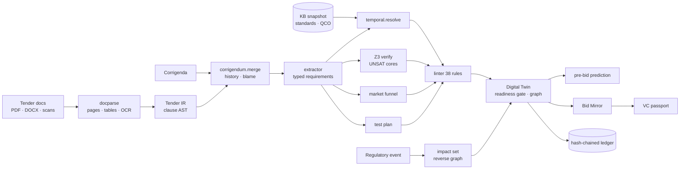

# SpecSure v2 — Architecture & Design Rationale

## 1. Design principles

1. **Evidence first, AI last.** Every conclusion is produced by a deterministic component (parser, rule, solver, registry lookup) and carries document → page → clause → span provenance. An LLM may *rephrase* a finding; it never *creates* one.
2. **A tender is a program.** It has syntax (clause tree), semantics (typed requirements), dependencies (standards, QCOs), and can be *compiled*, *linted*, *formally verified*, *diffed* and *re-built when a dependency changes*. We reuse proven software-engineering ideas: AST, static analysis, SMT, SARIF, git-style history, Dependabot, transparency logs.
3. **Time is a first-class dimension.** Standards, amendments and regulations have validity intervals; every resolution is *as of* a date.
4. **Human-in-the-loop by construction.** Publish gate, justified dismissals, committee decisions on equivalence and clarifications — all recorded in a tamper-evident ledger.
5. **Runs anywhere.** Zero-config SQLite + offline embeddings for a laptop demo; PostgreSQL + pgvector + real models in Docker.

## 2. Component map

| Layer | Module | Responsibility |
|---|---|---|
| Ingestion | `engine/docparse.py` | tiered parsing: Docling (opt.) → PyMuPDF text + `find_tables` → OCR (PyMuPDF-Tesseract / pytesseract / RapidOCR); DOCX body order; page preservation; SHA-256 |
| IR | `engine/tender_ir.py` | clause segmentation, annexures, headings, section typing, doc-type detection (tender / corrigendum / pre-bid / datasheet / certificate / test report) |
| Semantics | `engine/extractor.py`, `ontology.py`, `units.py`, `std_refs.py` | sentence-level requirement typing; constraint parsing (min/max/range/enum/tolerance/number words); unit normalisation; standard-citation normalisation (family + edition) |
| Knowledge | `engine/kb.py` | immutable snapshot of standards, relations, amendments, QCO registry (from DB or seed); snapshot hash |
| Time | `engine/temporal.py` | as-of resolution: cited edition vs edition in force, supersession chains, merged/withdrawn families, amendments in force/pending, QCOs in force/upcoming |
| Proof | `engine/constraints.py` | Z3 encoding (tracked assertions), engineering axioms (UTS ≥ TS/YS × YS, final ≥ initial setting …), deletion-based MUS minimisation, iterative conflict enumeration, clause-vs-standard pass, feasible windows |
| Market | `engine/market.py` | product-space funnel, leave-one-out and relax-to-standard counterfactuals, restriction index, verdicts |
| Lint | `engine/linter.py`, `sarif.py` | 38 rules (ambiguity, drafting, measurability, standards, certification, contradiction, restriction, completeness, security), autofixes, fingerprints, SARIF 2.1.0 |
| Twin | `engine/compiler.py` | orchestration, requirement linking, readiness scoring, pre-publication checklist, typed graph |
| Change | `engine/corrigendum.py`, `radar.py` | corrigendum parsing/merge/history/blame/draft generation; impact sets via reverse graph traversal; finding diffs |
| Foresight | `engine/prebid.py`, `memory.py` | question prediction with likelihood; TF-IDF clause precedents & similar tenders |
| Bidder | `engine/evidence.py`, `bidmirror.py`, `passport.py` | evidence extraction with strength grading; clause-by-clause evaluation; W3C VC issuance/verification |
| Trust | `engine/ledger.py`, `guardrails.py` | SHA-256 hash chain; prompt-injection screening, fencing, grounded-quote verification |
| Tests & labs | `engine/testplan.py` | test consolidation, lab routing, critical path |
| Services | `services/tender_service.py`, `bid_service.py`, `radar_service.py`, `ledger_service.py` | DB orchestration, review-state persistence, notifications |
| API | `routers/*.py` | REST (OpenAPI at `/docs`) |
| Agents | `mcp_server.py` | MCP tools over the same engine |

## 2A. Tender Studio, Knowledge Graph, Smart Bid Form (v2.1)

| Layer | Module | Responsibility |
|---|---|---|
| Graph | `engine/kg.py` (+ `data/engine/items.json`, `policies.json`) | Procurement Knowledge Graph: typed NetworkX multigraph built from the KB snapshot, parameter ontology, standards-parameter sets, lab scopes, policy layer, item layer and market catalogue. Temporal queries (`bundle`, `resolve_designation`), `impacted_items`, `explain_path`, Cypher / JSON-LD export. Cached by snapshot hash. |
| Intent | `engine/intent.py` | NL → line items (quantity, unit, item, slots); English/Hindi/Hinglish number words; typo-tolerant units; orphan quantities ranked by CO_PROCURED_WITH; minimal question set; optional LLM suggestion validated against the catalogue |
| Synthesis | `engine/synthesizer.py` | clause plan from KG bundles → rendered tender → compile → safe autofix loop → competition guard → DOCX with traceability annex; route advice (GFR 149/161) |
| Bidding | `engine/bidform.py` | form derivation from the twin, autofill from evidence, deterministic scoring (Match Index, knock-outs, headroom, path to compliance), declared-evidence document for the Bid Mirror |
| OCR | `engine/ocr.py` | RapidOCR PP-OCRv6 + PP-OCRv5 Devanagari ensemble, row grouping, domain repair, Tesseract fallback |
| Services / API | `services/studio_service.py`, `routers/studio.py`, `routers/kg.py`, `routers/marketplace.py` | persistence (`tenders.generation`, `bids.form`, `bids.match_index`), comparative statement, ledger entries (`tender.generated`, `bid.submitted`) |

```mermaid
flowchart LR
  U["Officer: 'need 500 light bulbs and 100 meteres'"] --> I[intent.parse<br/>items · qty · slots · questions]
  I --> Q{questions?} -->|answers| B
  KG[(Procurement KG<br/>valid-time)] --> B[bundle(item, publication date)<br/>editions · QCO/CRS/BEE/ALMM · tests · labs · policies]
  B --> P[clause plan + provenance]
  P --> R[render] --> C[Tender Compiler<br/>Z3 · 38 rules · market]
  C -->|safe autofix| P
  C --> G[competition guard] --> T[verified draft / publish]
  T --> F[bidform.derive_form] --> BF[contractor form]
  D[datasheet · licence · scanned NABL report] --> O[OCR + evidence] --> BF
  BF --> S[Match Index · knock-outs · path to compliance] --> CS[comparative statement]
```

## 3. The compile pipeline



## 4. Formal verification details

* Variables: one real per `<domain>.<parameter>` (e.g. `steel.yield_strength`) — so "compressive strength" of cement and concrete never collide.
* Each requirement is `assert_and_track`-ed with its requirement id as the tracking literal; non-negativity is background.
* Engineering axioms (from `data/engine/parameters.json → derived_relations`) are tracked too, so they appear in explanations ("Engineering relation: UTS ≥ TS/YS × YS").
* On UNSAT, the unsat core is minimised by deletion into a **MUS**; its tender atoms are removed and solving repeats to enumerate independent conflicts.
* A second pass checks each tender atom against the cited standard's grade requirements (`standards_parameters.json`) → "clause contradicts the standard it cites".
* Without Z3 installed the engine degrades to per-variable interval propagation.

## 5. Temporal model

Each standard record has `effective_from`, `effective_to`, `status`, `superseded_by`. `resolve(citation, as_of)`:
1. normalise to family + year; 2. find the cited edition and the edition in force on `as_of`; 3. follow supersession chains (detects *family changes*, e.g. IS 8112 → IS 269); 4. split amendments into in-force vs pending; 5. list regulations in force vs upcoming within a horizon. The tender's `as_of` defaults to its publication date and can be changed in the UI (time machine).

## 6. Restriction analysis

For each product domain the catalogue is filtered by legal gates (licence under QCO) and requested grade/sizes, then by each parameter clause in document order (funnel). For every clause: products eligible *without* it (leave-one-out) and with it *relaxed to the cited standard's limit*. A clause is **restrictive** when it is stricter than the standard and removes ≥ 50 % of otherwise-eligible manufacturers or drops competition below three. Contradictory clauses are excluded first (otherwise every clause looks irrelevant).

## 7. Trust & governance

* **Ledger**: `entry_hash = SHA-256(prev_hash ‖ JCS(entry))`; compile entries include document hashes, KB snapshot hash, engine and solver versions → any past result can be reproduced and any edit is detectable (`GET /ledger/verify`).
* **Review state** is keyed by finding fingerprints (`rule | clause | requirement ids`), so re-compiles don't lose human decisions; dismissals require justification; publishing is refused (HTTP 409) while critical findings are open.
* **Guardrails**: untrusted documents are scanned for injection patterns and zero-width smuggling; LLM prompts fence document text; LLM claims must carry quotes that are verified against the source.
* **Passports**: W3C VC 2.0 with Data Integrity proof (`eddsa-jcs-2022`), verifiable offline from the `did:key`.

## 8. Data model (new tables)

`tenders`, `tender_documents`, `finding_states`, `prebid_items`, `bids`, `bid_documents`, `regulatory_events`, `notifications`, `audit_ledger`, `passports`, `reviews`, `source_snapshots` (+ `regulations.key/scheme/verification_state`, `analysis_results.analysis_uid`). `init_db` performs forward-only column auto-migration so existing Docker volumes keep working.

## 9. Scaling path

* KB snapshot is cached per compile; for thousands of standards load it once per process and invalidate on radar events.
* Compile is CPU-bound and stateless → horizontal workers (e.g. a task queue) behind the same API.
* Market catalogue → GeM catalogue + BIS licence feeds; lab directory → NABL scopes; memory → embeddings in pgvector.
* Authentication/RBAC (deferred) slots in at the router layer; the ledger already records an `actor` for every action.
